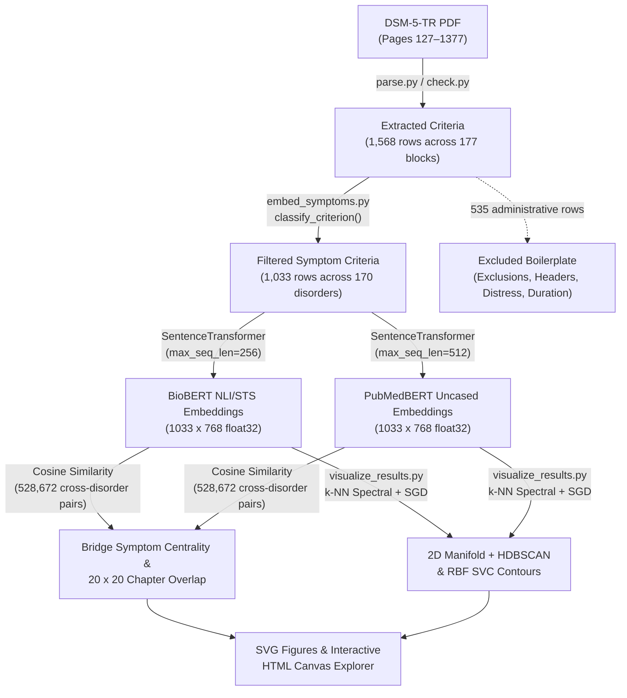
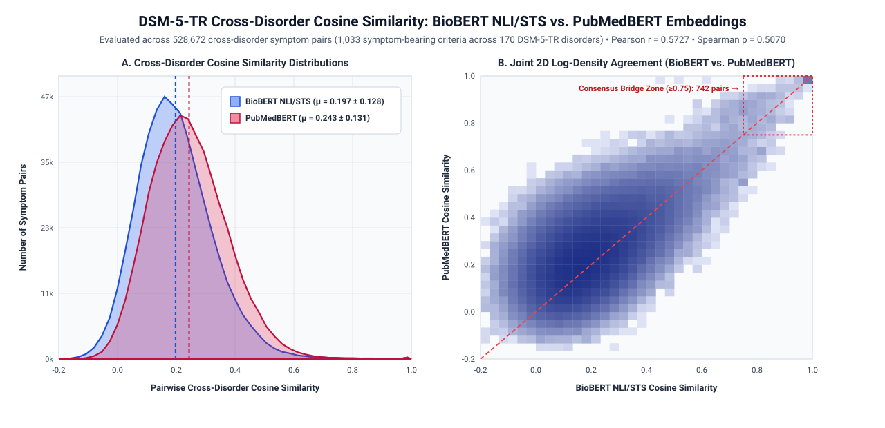
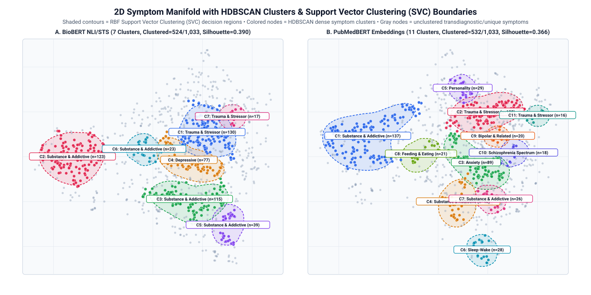
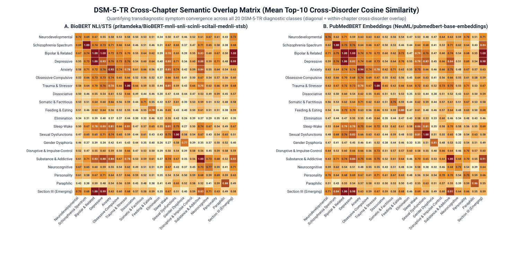
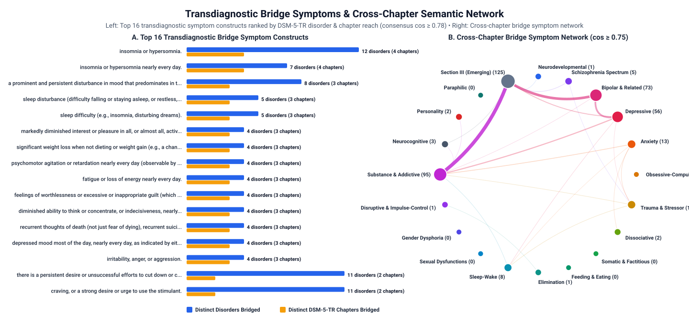

# DSM-5-TR Symptom Vectorization & Transdiagnostic Clustering


An open-science computational psychology pipeline that encodes *DSM-5-TR* diagnostic criteria into **768-dimensional biomedical embedding spaces** to quantify cross-disorder semantic overlap, identify transdiagnostic bridge symptoms, and evaluate empirical symptom clustering via **HDBSCAN** and **Support Vector Clustering (SVC)**.

> [!IMPORTANT]
> **Copyright-Safe "Dehydrated" Repository**: To comply with [APA Publishing copyright policies](https://www.appi.org/support/customer-information/permissions), verbatim *DSM-5-TR* text and the source PDF are excluded via `.gitignore`. This repository distributes all pipeline code, **non-invertible `768`-d `.npy` embedding matrices**, **SHA-256 checksums**, and a **dehydrated metadata index** (`outputs/dsm_symptoms_metadata_public.json`) so all clustering, similarity, and visualization analyses run out of the box.

---

## 1. Research Objectives

1. **Cross-Disorder Semantic Overlap**: Which *DSM-5-TR* diagnostic chapters share the highest latent semantic similarity once administrative boilerplate and exclusion criteria are removed?
2. **Transdiagnostic Bridge Symptoms**: Which individual symptom constructs act as high-centrality semantic bridges connecting distinct diagnostic classes?
3. **Data-Driven Symptom Taxonomy (`HDBSCAN` & `SVC`)**: How do unsupervised density clusters and radial basis function (RBF) Support Vector Clustering boundaries compare against categorical *DSM-5-TR* chapters across different biomedical language models?

<details>
<summary><strong>Repository Structure & Data Dictionary (Click to expand)</strong></summary>

```text
DSM5TR_vec/
├── .gitattributes                                         # Excludes generated HTML/outputs from GitHub Linguist stats
├── .gitignore                                             # Excludes .venv/, PDFs & verbatim full-text extracts
├── parse.py                                               # PDF diagnostic criteria parser (pages 127–1377)
├── check.py                                               # Continuity & structural integrity assertion suite
├── embed_symptoms.py                                      # Non-symptom filter & dual-model 768-d embedding pipeline
├── visualize_results.py                                   # Manifold projection, HDBSCAN, SVC & figure generator
├── requirements.txt                                       # Pinned Python dependencies
└── outputs/
    ├── dsm_symptoms_metadata_public.json                  # Dehydrated metadata, SHA-256 & 2D cluster index (1,033 rows)
    ├── criterion_filter_audit_public.csv                  # 1,568-row filter audit (symptom vs. non_symptom:*)
    ├── embeddings_biobert_nli_stsb_768d.npy               # L2-normalized (1033, 768) float32 matrix (BioBERT NLI/STS)
    ├── embeddings_pubmedbert_embeddings_768d.npy          # L2-normalized (1033, 768) float32 matrix (PubMedBERT)
    ├── bridge_symptoms_biobert_nli_stsb_public.csv        # Public bridge symptom centrality rankings (BioBERT)
    ├── bridge_symptoms_pubmedbert_embeddings_public.csv   # Public bridge symptom centrality rankings (PubMedBERT)
    ├── consensus_cross_disorder_bridge_pairs_public.csv   # Top 100 cross-disorder pairs by consensus z-score
    ├── embedding_comparison_summary.json                  # Distributional & inter-model correlation metrics
    ├── clustering_evaluation_summary.json                 # HDBSCAN/SVC metrics, chapter overlaps & bridge constructs
    └── figures/
        ├── dsm5tr_interactive_explorer.html               # Standalone interactive 2D symptom manifold explorer
        ├── fig1_inter_model_comparison.svg                # Cross-disorder cosine distributions & 2D log-density
        ├── fig2_chapter_overlap_heatmap.svg               # 20 × 20 DSM-5-TR chapter semantic overlap heatmaps
        ├── fig3_manifold_hdbscan_svc.svg                  # 2D manifold with HDBSCAN clusters & SVC RBF contours
        └── fig4_bridge_symptom_ranking_and_network.svg    # Top bridge constructs & cross-chapter network
```

**Public Metadata Schema (`outputs/dsm_symptoms_metadata_public.json`)**:
* `symptom_index` (`int`): Row index (`0–1032`) aligned with the `.npy` embedding matrices.
* `disorder` & `chapter` (`str`): Standardized *DSM-5-TR* disorder (`170` blocks) and overarching diagnostic chapter (`20` classes).
* `criterion_id` & `criterion_level` (`str`): Hierarchical ID (`A`–`I`, `1`–`13`, `1a`–`1i`, `1ai`–`1av`) and level (`main_criterion` vs. `sub_symptom`).
* `clinical_concept_label` & `text_sha256` (`str`): Non-verbatim clinical concept tag and 16-char SHA-256 hash of `embedding_text`.
* `biobert_2d` / `pubmedbert_2d` (`list[float]`) & `*_cluster` (`int`): 2D manifold coordinates and HDBSCAN/SVC cluster IDs (`-1` = unclustered bridge/unique symptom).

</details>

---

## 2. Methodology & Pipeline Architecture



1. **Hierarchical Criteria Extraction (`parse.py`, `check.py`)**: Extracts Section II and III criteria across pages 127–1377 (`1,568` total criteria across `177` disorder/episode entries: `723` `main_criterion` and `845` `sub_symptom`) while stripping ICD-10-CM codes and narrative sections.
2. **Syntax-Preserving NLP & Non-Symptom Filtering (`embed_symptoms.py`)**: Standardizes text to lowercase and strips list enumerators (`a.`, `1.`) and inline `(note: ...)` remarks while **retaining stopwords and clinical inflection** (no lemmatization). `classify_criterion()` removes `535` administrative rows and retains **`1,033` symptom-bearing criteria across `170` disorders**:

| Filter Category (`criterion_category`) | Rows | Share | Description |
| :--- | ---: | ---: | :--- |
| **`symptom` (Retained)** | **1,033** | **65.9%** | Sub-symptoms and standalone symptom-bearing main criteria |
| `non_symptom:exclusion_or_etiology` | 225 | 14.3% | Differential diagnosis rule-outs (*"not better explained by..."*) & medical/substance attribution |
| `non_symptom:structural_header` | 151 | 9.6% | Parent list headers introducing sub-items (*"Five (or more) of the following..."*) |
| `non_symptom:distress_or_impairment` | 102 | 6.5% | Clinical significance / occupational impairment boilerplate |
| `non_symptom:onset_duration_age` | 41 | 2.6% | Standalone chronological, age, or duration thresholds |
| `non_symptom:structural_prereq` | 16 | 1.0% | Cross-box prerequisites (*"The criteria are met for..."*) |

3. **Dual-Model 768-d Biomedical Vectorization (`embed_symptoms.py`)**: Encodes all `1,033` symptom criteria into L2-normalized `768`-d vectors (`normalize_embeddings=True`) using [`pritamdeka/BioBERT-mnli-snli-scinli-scitail-mednli-stsb`](https://huggingface.co/pritamdeka/BioBERT-mnli-snli-scinli-scitail-mednli-stsb) (`max_seq_length=256`) and [`NeuML/pubmedbert-base-embeddings`](https://huggingface.co/NeuML/pubmedbert-base-embeddings) (`max_seq_length=512`, uncased).
4. **Manifold Projection, HDBSCAN & SVC (`visualize_results.py`)**: Projects the `k=15` nearest-neighbor cosine graph into 2D space via spectral initialization and attraction-repulsion SGD, condenses the mutual-reachability Minimum Spanning Tree via **HDBSCAN** ($k_{\text{core}}=7, n_{\min}=16$), and traces closed radial basis function (**RBF**) **Support Vector Clustering (SVC)** decision contours ($\gamma = 0.45$).

---

## 3. Key Empirical Findings

### 3.1. Inter-Model Comparison (`528,672` Cross-Disorder Pairs)



| Metric | [`BioBERT NLI/STS`](https://huggingface.co/pritamdeka/BioBERT-mnli-snli-scinli-scitail-mednli-stsb) | [`PubMedBERT Embeddings`](https://huggingface.co/NeuML/pubmedbert-base-embeddings) |
| :--- | :--- | :--- |
| **Cross-Disorder Cosine Mean ± SD** | `0.1972 ± 0.1276` | `0.2435 ± 0.1308` |
| **Inter-Model Agreement (`528,672` pairs)** | `Pearson r = 0.5727` | `Spearman ρ = 0.5070` |
| **HDBSCAN Condensed Clusters** | `7` clusters | `11` clusters |
| **Clustered vs. Unclustered Bridge Symptoms** | `524` (`50.7%`) / `509` (`49.3%`) | `532` (`51.5%`) / `501` (`48.5%`) |
| **2D Cluster Silhouette Score** | `0.3902` | `0.3659` |

---

### 3.2. Symptom Manifold, HDBSCAN Clusters, SVC Boundaries & Interactive Explorer



* **Core vs. Interstitial Architecture**: Both models group `~51%` of criteria into dense phenomenological clusters bounded by RBF SVC contours while leaving `~49%` as unclustered interstitial points that bridge diagnostic boundaries.
* **Granularity Differences**: Uncased **PubMedBERT** resolves finer-grained clinical sub-clusters (`11` vs. `7` in BioBERT), cleanly separating sleep-wake dyssomnias (`C6`), appetite/weight disturbances (`C8`), and neurocognitive-executive decline (`C7`) from general mood and substance clusters.
* **Interactive 2D Manifold Explorer (`outputs/figures/dsm5tr_interactive_explorer.html`)**: Alongside the static manifold plot, `visualize_results.py` compiles a lightweight HTML5 Canvas explorer storing compact 10-element node tuples (`[disorder, chapter, criterion_id, concept_label, bx, by, bc, px, py, pc]`). It supports real-time switching between **BioBERT** and **PubMedBERT** spaces, toggling node colors between **HDBSCAN/SVC clusters** and the **20 DSM-5-TR chapters**, instant keyword filtering, and nearest-neighbor hover inspection.

---

### 3.3. Cross-Chapter Semantic Overlap (`20 × 20` *DSM-5-TR* Classes)



| DSM-5-TR Chapter 1 | DSM-5-TR Chapter 2 | BioBERT Top-10 Mean | PubMedBERT Top-10 Mean | Consensus Mean |
| :--- | :--- | ---: | ---: | ---: |
| **Bipolar & Related** | **Depressive** | `1.0000` | `1.0000` | `1.0000` |
| **Bipolar & Related** | **Section III (Emerging)** | `1.0000` | `1.0000` | `1.0000` |
| **Depressive** | **Section III (Emerging)** | `0.9902` | `0.9808` | `0.9855` |
| **Substance & Addictive** | **Section III (Emerging)** | `0.8267` | `0.9081` | `0.8674` |
| **Depressive** | **Substance & Addictive** | `0.8828` | `0.8437` | `0.8632` |
| **Anxiety** | **Substance & Addictive** | `0.8435` | `0.7513` | `0.7974` |
| **Depressive** | **Sleep-Wake** | `0.8029` | `0.7831` | `0.7930` |
| **Bipolar & Related** | **Substance & Addictive** | `0.8284` | `0.7420` | `0.7852` |
| **Bipolar & Related** | **Sleep-Wake** | `0.7805` | `0.7867` | `0.7836` |
| **Anxiety** | **Sleep-Wake** | `0.8135` | `0.7526` | `0.7831` |
| **Anxiety** | **Trauma & Stressor** | `0.7844` | `0.7780` | `0.7812` |

---

### 3.4. Transdiagnostic Bridge Symptoms & Cross-Chapter Network



* **Sleep-Wake Dyssomnia Hub**: *Insomnia/hypersomnia* bridges **`12` disorders across `4` chapters** (`Depressive`, `Bipolar & Related`, `Substance & Addictive`, `Section III`; BioBERT `0.8968–0.9510`, PubMedBERT `0.8389–0.9027`).
* **Sleep Continuity & Arousal Bridge**: *Difficulty falling/staying asleep or restless sleep* bridges **`5` disorders across `3` chapters** (`Anxiety`, `Trauma & Stressor`, `Substance & Addictive`; BioBERT `0.9476`, PubMedBERT `0.9314`).
* **Affective & Externalizing Bridges**: *Elevated/irritable mood disturbance* links **`8` disorders across `3` chapters** (`Bipolar`, `Depressive`, `Section III`), while *irritability, anger, or aggression* links **`4` disorders across `3` chapters** (`Substance & Addictive`, `Depressive`, `Personality`; consensus `0.8375`).
* **Compulsive Control & Craving Axis**: *Unsuccessful efforts to cut down* and *craving* bridge **`11` disorders across `Substance & Addictive` and `Section III`** (`Caffeine Use`, `Internet Gaming`), with stronger substance-name invariance in PubMedBERT (`0.8898–0.8956`) than BioBERT (`0.8155–0.8231`).

---

## 4. Quickstart & Reproducibility

```bash
# 1. Set up Python 3.12 virtual environment (prebuilt Apple Silicon wheels for torch/umap/hdbscan)
uv venv --python 3.12 --clear .venv
uv pip install --python .venv/bin/python -r requirements.txt

# 2. Reproduce clustering & figures directly from public .npy embeddings (no PDF required)
.venv/bin/python visualize_results.py
```

<details>
<summary><strong>Full Local Rehydration from a Licensed DSM-5-TR PDF</strong></summary>

Place a licensed copy of `DSM 5 TR-APA (2022).pdf` in the repository root and run:

```bash
.venv/bin/python parse.py           # Extracts dsm_symptoms_cleaned_full.json
.venv/bin/python check.py           # Verifies continuity & 0 structural leaks
.venv/bin/python embed_symptoms.py  # Filters boilerplate & encodes 768-d vectors
.venv/bin/python visualize_results.py
```

</details>
